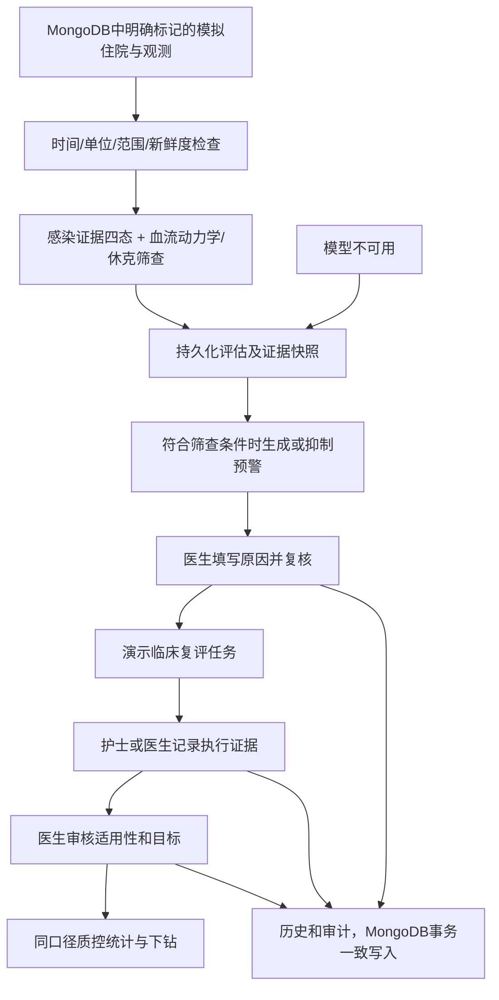
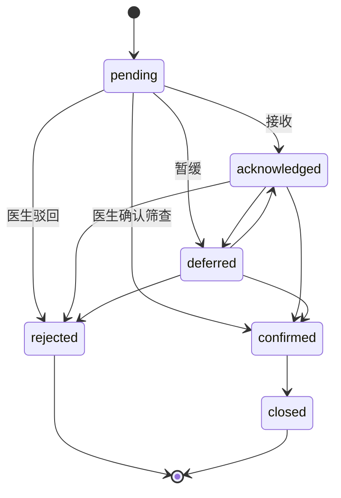

# 产品、架构与领域状态

## 目标与实际范围
目标是在现有 ICU 医生模块内支持证据审查、规则筛查、医生处置、护士协作与质量追踪。现阶段为独立开发验证容器，不冒充宿主已经集成；顶部导航仅用于本次独立演示。未来接入宿主必须替换为真实导航/患者选择/身份桥接。

已实现路由：风险总览、患者列表、患者证据/评估详情、预警中心、Bundle工作台、质控、模型状态、登录。前端使用真实 /api/v1 接口，不在前端编造患者、预警、统计数字。生命体征目前是带单位、事件时间与来源的表格，尚未实现时序曲线。

## 模块结构
- `domain`：实体与不依赖HTTP的临床规则服务。
- `application`：评估编排、预警/任务工作流、查询、授权与审计存储。
- `integration`：ClinicalDataProvider及本系统Mongo观测读取实现，真实源适配尚未实现。
- `prediction`：RiskModelProvider与完整的Unavailable实现，不伪装成真实推理。
- `api`：显式DTO视图、输入校验、统一响应与错误映射，不直接暴露Mongo实体。
- `config`：RBAC、随机环境密码、独立数据库索引和演示初始化。
- Angular：每个独立页面一个模块，统一类型、HTTP服务、认证拦截器与展示规则。

采用模块化单体，不引入Kafka、Kubernetes或微服务。Spring Boot 2.7.18是Java15兼容选择，非生产长期安全维护承诺。Spring Security 5.7与Spring Data Mongo版本从该BOM管理，实际依赖见环境文件。没有MySQL、MyBatis或Flyway；MongoDB用幂等索引初始化脚本，后续结构迁移需版本化。

## 预警状态机

确认不等于临床诊断。关闭前必须已确认。关闭/驳回移除活跃键。暂缓当前不带自动到期任务，需人工复评；不能声称已实现可靠的自动复评。

重复抑制键为科室+患者+住院+规则版本+严重度+配置化时间桶（默认30分钟），唯一索引和事务防止重复活跃记录；不同严重程度不会被低等级键阻挡。桶边缘仍可能短间隔再次预警，需临床评估预警负担；此策略不是已验证生产策略。

## Bundle四维
- applicability：required / conditional / individualized / not_applicable / contraindicated / review_pending。
- executionStatus：本版本产生not_started/met/met_late/completed_before，数据模型兼容data_missing等，但未实现全部流转。
- targetStatus：met / not_met / unknown / not_assessed；目标达成需证据与医生审核，不根据一条记录自动假定。
- clinicalReviewStatus：pending / confirmed；执行记录会使审核重新pending。overridden审批流尚未实现。

只有医生能确认筛查及适用性；护士只能在授权科室查看数据、记录执行证据。质控可以查看授权数据和统计，不能修改临床状态。尚无可用的管理员配置界面。

## 并发与一致性
每次写命令必须带Idempotency-Key和预期version（评估无version）。命令指纹包含动作/路径/负载，同键不同负载409；重复同请求不重复创建。重新返回当前资源状态，不保证逐字回放最初HTTP响应。业务对象、历史、审计、幂等记录在同一Mongo事务中提交；失败回滚。冲突返回409，由用户刷新后明确重试，不做隐式无限重试。

T0与createdAt分开；观测eventTime与ingestTime分开；执行使用实际eventTime计算是否超时，不用补录入库时间替代。统一存储UTC Instant，界面按浏览器时区显示。无自动医嘱或自动治疗。
