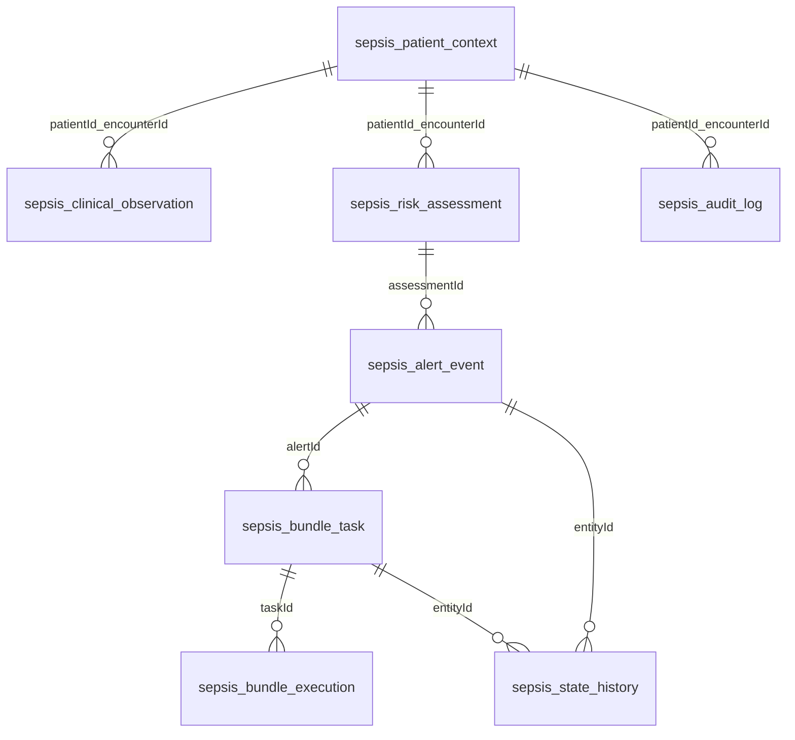

# MongoDB 数据设计与接口映射

## 已实现集合（与代码一致）
所有患者业务实体使用独立字符串UUID/_id；模拟患者有可识别的demo-* ID。patientId是本系统患者键，encounterId是住院键，外部hisPid/ObjectId不自动等同。`version`由Spring Data乐观锁维护。

|集合|实际文档与生命周期|主要查询 / 索引|
|---|---|---|
|sepsis_patient_context|患者住院上下文、床位、显示标识、科室、模拟标记|科室+createdAt；后续住院转科模型待扩展|
|sepsis_clinical_observation|每项观测独立文档，Double值/文本、单位、事件/入库时间、来源及质量状态|patientId+encounterId+eventTime；sourceSystem+sourceRecordId唯一|
|sepsis_risk_assessment|评估、T0、规则版本、感染/筛查结论、缺失项、有限证据快照和3个不可用预测结果|科室+createdAt；patientId+encounterId+createdAt复合索引|
|sepsis_alert_event|预警当前状态、证据评估ID、严重度、规则版本、响应/关闭时间|department+status+createdAt；activeKey字符串部分唯一索引|
|sepsis_bundle_task|四维状态、触发/截止/完成时间、审批状态、执行证据ID|alertId+itemCode唯一；department+dueAt；department+triggerTime|
|sepsis_bundle_execution|独立不可覆盖执行记录、操作者、来源/事件/入库时间|taskId+sourceSystem+sourceRecordId唯一|
|sepsis_state_history|独立历史文档，每次变更一条before/after及原因|entityId+createdAt；不使用无限增长嵌套历史|
|sepsis_audit_log|操作者、动作、关联、原因、traceId；业务API无修改/删除入口|科室+createdAt；生产需只追加数据库角色/WORM归档|
|sepsis_command|actor+key哈希主键、负载指纹与结果实体关联|_id唯一，无TTL；保留期需医院定义，禁止任意过期破坏幂等|

当前仅3位模拟患者。生产每日写入量、留存期、磁盘/副本/备份容量尚无现场数据，不能虚构容量结论。高频监护观测预计远多于评估与预警，须实测后再决定归档、分区、时序集合和压缩。

没有把推荐的18个集合机械全部创建；感染判断嵌在一次评估的有限快照里，历史/执行/审计独立分页。没有模型时不制造模型运行/验证记录集合。索引初始化为幂等ensureIndex；现阶段没有复杂结构迁移。迁移生产前应增加版本登记、预演和回滚备份，不允许drop数据库。

## 当前输入字典
|code|单位|用途|
|---|---|---|
|HR|bpm|展示与质量校验|
|MAP / SBP|mmHg|血流动力学筛查|
|RR|/min|qSOFA显式筛查分数|
|GCS|score|qSOFA；非完整SOFA|
|LACTATE|mmol/L|异常与休克筛查证据|
|VASOPRESSOR_ACTIVE|boolean，0/1|只有模拟状态，不冒充真实剂量契约|
|DIAGNOSIS|文本|保守四态证据筛查，不等同临床诊断|

单位不匹配不直接换算，拒绝参与规则；待取得正式单位映射后实现带版本换算。未来事件、预测时点后才入库的记录不进入评估。生命体征默认新鲜度120分钟、检验/诊断360分钟，仅开发示例，不能视为批准的临床时窗。查询最多24小时2000条，未来需实现明确游标分页及超限拒评，不适合无边界高频生产数据。

## 参考项目的源系统映射（未连库核验）
- SmartCare.patient._id → bedside.pid / drugExe.pid / deviceBind.pid。
- patient.hisPid → DataCenter.VI_ICU_EXAM / VI_ICU_EXAM_ITEM的hisPid。
- 设备数据需deviceID与有起止时间的deviceBind关联，不能只用当前绑定归属历史数据。
- 配置还涉及patient、deviceCap、deviceOnline、configParam、configDrug、VI_ICU_report；医院变体可能使用其他库名/字段。

这些来自参考源码，不代表本医院真实接口已确认。真实接入应使用独立只读账号、独立连接、映射版本、住院键及绑定有效区间；新业务只写新库sepsis_*集合。不把仓库里的连接地址/凭据复制进交付物。
